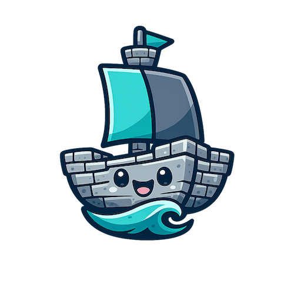
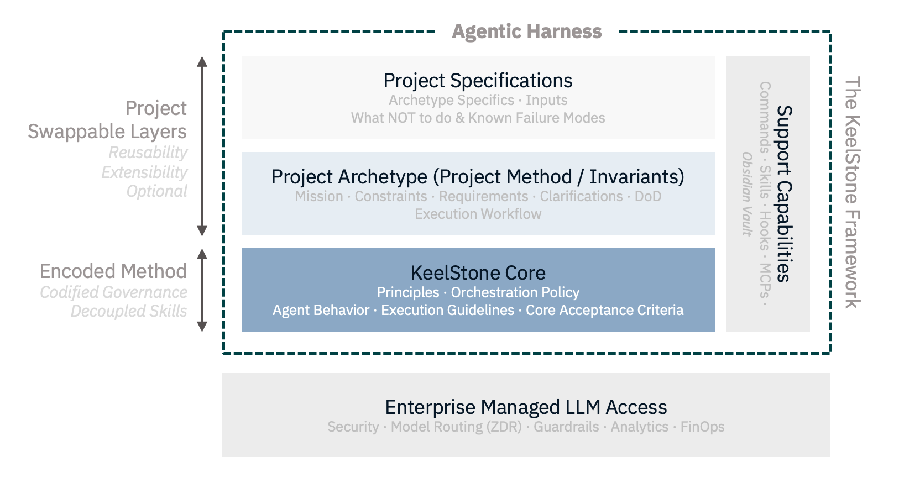

<div align="center">


<br>

# The KeelStone Framework
</div>

## Overview

KeelStone helps teams or individuals hand off real, end-to-end work to AI agents, and get results that are consistent, traceable and ready for enterprise use.

It can be used in two ways:

| Use Case | What it is | Who it's for |
|---|---|---|
| **As a Framework to codify complex and repeatable work** | An open, enterprise-grade **Method-as-Code** framework for agentic harnesses | Organizations that want to encode *how* they deliver work |
| **As a Software Product** | An enterprise-ready **multi-agent management and governance system** for agentic harnesses | End users ("prosumers") who delegate work to AI agents |

>[!IMPORTANT]
> What is an **agentic harness**: An agentic harness wraps an AI model and gives it what it needs to run as an agent: **tools**, **memory** and an **agentic loop**. Examples include Claude Code, Codex, IBM Bob and OpenCode.
> KeelStone works **at the agent level, inside the harness**. It does not replace the harness. It tells the agent *how to work*.

### How it works



KeelStone currently works as a plug-in for Claude Code or Codex (more to come) and provides a series of **features & capabilities** to the agentic harness:

- **Layered and reusable.** The Core stays the same across projects. Archetypes capture the invariant aspects for a specific project type, and project specifications capture one specific engagement/case. You can reuse them per project or per user.
- **Clean separation** between framework files and project files.
- **Concurrent work from agents and humans**, supported through Git or Cloud-synced folders (for individuals and small teams with low concurrency).
- **Flexible UIs**, using either a CLI or a desktop environment.
- **Tailorable**, so you can extend or adapt the framework as you see fit.

KeelStone gives agents and humans a **standardized way to work together**, using a set of structured files on disk that provide:

- **Context Grounding** for long-running, distributed jobs
- **Resilience**, so restarts and re-runs pick up from the recorded state
- **An audit trail** that AI can inspect

Some of these files are:

| Log | Purpose |
|---|---|
| **Decisions log** | Records decisions with unique IDs and cross-references (referential integrity), human-in-the-loop escalation criteria and an audit trail |
| **Handoffs log** | Structures delegation between agents (BEGIN/END markers) and captures what each agent learned |
| **Lessons log** | Creates positive feedback loops. Lessons are generalized over time to improve the framework, and include model-optimization primitives |
| **Events log** | Keeps full provenance (*who, when, why*) using a defined schema of event types and statuses |

In essence, KeelStone provides a "RAID log" that **articulates the relationship between agents and humans**. This is far more efficient and scalable than reading through long conversation histories (which might be distributed across different computers) and provide a better foundation to also use agents to inspect and evaluate what is happening within a project, either at run time or when everything has finished.

### Key benefits

| Capability | What you get |
|---|---|
| **Industrial-grade execution**: versioning, context and loops that improve themselves | Better reliability, less rework, consistent reproducibility, continuous improvement that is codified |
| **Delegation**: to more agents, between teams, between professionals | More capacity, flexibility and scalability |
| **Built-in governance**: audit trails, post-mortems, validation that is enforced and deterministic | Better quality, codified compliance, more security, a lower barrier to entry |
| **Reusable use cases**: by project type, customer, scenario or offering | Faster execution and efficiency gains that compound over time |

### What makes it different

- **Open.** You can inspect, reuse, combine and extend it.
- **Agnostic.** It works across domains, not just the software lifecycle, and across harnesses (currently **Claude Code** and **Codex**).
- **Enterprise-ready.** It is traceable, auditable, predictable and verifiable, because it rests on ledgers and rules that enforce quality and conformance.

## Start here

| You want to… | Read |
|---|---|
| Install the framework and arm a first project | `docs/getting-started.md` (10 steps, both harnesses) |
| Run everyday operations: switch routing, update, archive, second session, upgrade | `docs/operations.md` |
| Every `ks` command | `docs/ks.md` |
| Understand a design decision | `docs/decisions/` (ADRs 0001–0009) |

The rest of this file is for maintainers of the framework repository.

Harness-neutral method framework for Codex CLI and Claude Code: an `AGENTS.md`-driven method
(the CORE text, YAML ledgers, state snapshot, deliverables registry) plus the tooling that enforces
it (hash-based edit tracking, ledger validation on write, SessionStart state injection, Stop-time
reminders) and the Group-A skills.

## Repository layout

```
TKSfw/
├── VERSION                          single source of the framework version (semver)
├── template/                        the per-project method INSTANCE (what new_project.py copies)
│   ├── AGENTS.md                    the CORE layer; ARCHETYPE / PROJECT stay per project as KS_PROJECT.md / KS_SPEC.md (docs/decisions/0016)
│   ├── CLAUDE.local.md              `@AGENTS.md`
│   ├── .agents/hooks/               hook scripts + hooks.json (single source; in-project layout)
│   ├── .agents/skills/              Group-A skills incl. define-agent, delegate-work, ks-start, ks-reload (single source for both harnesses)
│   ├── .agents/config.toml          model routing: tiers → provider tables (docs/model-routing.md)
│   ├── .agents/agents/              agent definitions (neutral source; hooks render .codex/agents + .claude/agents)
│   ├── .agents/workarea/.keep       ledgers, tasks.md, STATE.md live here at runtime
│   └── .codex/                      config.toml, prompts/, agents/
├── plugin-src/                      hand-maintained plugin sources (manifests, README, tksfw-init, bootstrap, tksfw-tools)
│   ├── tksfw/                       manifests, README, skills/tksfw-init (project instantiation from the plugin), bootstrap/ stanzas
│   └── tksfw-tools/                 both manifests, mcp/codex.json, mcp/claude.json, hooks/check_tools.py
├── plugins/                         GENERATED from template/ + plugin-src/ — committed so a clone installs without a build
│   ├── tksfw/                       skills + hooks + both manifests
│   └── tksfw-tools/                 Perplexity + Playwright MCP servers (optional companion)
├── .agents/plugins/marketplace.json Codex catalog  → ./plugins/*
├── .claude-plugin/marketplace.json  Claude Code catalog → ./plugins/*
├── tools/
│   ├── build_plugin.py              template → plugins/tksfw + dist/*.zip (+ --check for drift)
│   ├── new_project.py               instantiate / update a project from template/ (full or --plugin-mode)
│   └── release.sh                   bump VERSION, test, build, commit, tag
├── tests/run_tests.py               skill suite + build + plugin-mode & in-project hook runs
├── docs/
│   ├── distribution.md              how to build, release and install (git, ZIP, archive, manual)
│   ├── model-routing.md             tiers, roles, routing tables, mid-session switching
│   ├── mcp-tools.md                 the tksfw-tools plugin (MCP servers, secrets, prerequisites)
│   ├── user-level.md                install once per user, arm/disarm per project, off switches
│   ├── ks.md                        the `ks` command line (all operations in one place)
│   └── decisions/                   ADRs (0001 repository layout)
├── dist/                            build output (git-ignored)
├── CHANGELOG.md
└── CREDITS.md                       maintainers, contributors, thanks
```

Edit only `template/` and `plugin-src/`. `plugins/*` is regenerated by the build (`tools/build_plugin.py`, or `ks dev build`) and checked by
`tests/run_tests.py` (`build_plugin.py --check`), so a stale copy fails the tests.

## Documentation

| Document | Description |
|---|---|
| [Getting Started](docs/getting-started.md) | Go from zero to the first armed project |
| [Deployment](docs/user-level.md) | KeelStone gets installed once per user and 'armed' on a per-project basis |
| [Operations](docs/operations.md) | Description of each of the different procedures that KeelStone provides |
| [The KeelStone CLI](docs/ks.md) | KeelStone provides `ks` command to facilitate its use and operation |
| [Model Routing](docs/model-routing.md) | Explains how to configure Model Routing tables that Agents will use during execution sessions |
| [MCP Tools](docs/mcp-tools.md) | KeelStone provides a second plugin with optional MCP servers |
| [Build and Distribution](docs/distribution.md) | Procedure to build and distribute TKSfw plugins |

## Versioning

Semver in `VERSION`. Every CORE-layer change is a release (matching the Layer taxonomy in
`AGENTS.md`); bump the version even for small plugin changes, because Claude Code updates only on
a version change and Codex reloads local plugins on restart.
